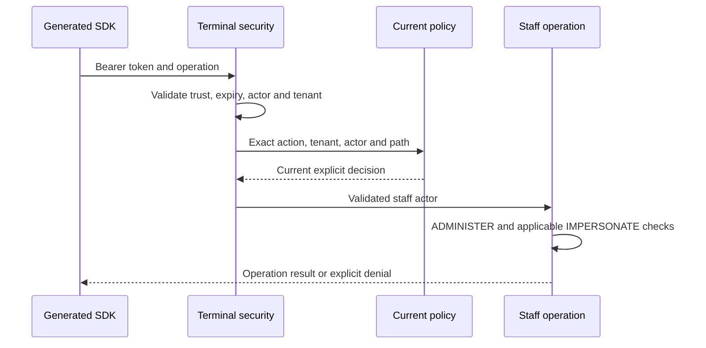

# Configure the insurance staff terminal and its generated SDK

The terminal accepts an institution-issued signed access token, evaluates current resource policy, and then runs its staff and customer-operation checks. A session lookup does not issue a token or authenticate a username. The financial/insurance owner remains responsible for its business decisions and durable effects.

## Request flow



Authentication, the current policy decision and legacy staff checks all apply. An unavailable identity/access dependency cannot create a synthetic success. The terminal's business record/configuration adapters may still be selected as sandbox implementations; this does not select or bypass employee authentication.

## Header tokens, retained sessions, and CSRF

Staff APIs authenticate through an explicit signed `Authorization: Bearer <token>` header. The terminal's own security chain does not load or save authentication through a WebSession. A session containing an authenticated context from another server component cannot authorize staff reads or writes. The business session lookup is not a browser login and adds no token-delivery endpoint.

The chain retains native Spring Security CSRF protection and its header-bearer exemption. Properly signed bearer POST, PUT, PATCH and DELETE requests do not require a CSRF token; token validation and current staff/resource policy still apply. A conflicting authenticated session does not change the bearer identity, and an invalid bearer cannot fall back to that session.

Unsafe non-bearer requests without a valid native CSRF token return 403 before staff authentication or business effects. This intentionally changes the earlier anonymous-POST 401 response. A safe protected request without a valid bearer remains 401; even a valid CSRF token does not make a session an API identity. The configured public routes are GET health/OpenAPI only. Keep browser/session-login flows in an explicitly designed application chain with appropriate CSRF controls.

## Configure issuer trust and current policy

Supply these properties in the selected environment. The placeholders below are deployment inputs, not built-in credentials or a runnable institution policy:

```yaml
firefly:
  security:
    resource-server:
      strict-policy: true
  terminal:
    security:
      issuer: ${STAFF_ISSUER}
      audience: ${STAFF_AUDIENCE}
      jwk-set-uri: ${STAFF_JWKS_URI}
    adapter: sandbox
api-configuration:
  domain-platform:
    security-center:
      base-path: ${SECURITY_CENTER_URL}
```

Use the issuer's intended audience and JWKS endpoint. The accepted token must have a validated RSA signature, matching issuer/audience, a future finite expiration, a nonblank subject, and canonical UUID string claims `tenant_id` and `staff_actor_id`. The provider subject is not assumed to be the employee UUID. The principal retains the signed claims and projects the actor into `attributes.staffActorId`; the tenant is the signed `tenant_id`.

An empty trust configuration denies staff authentication. The terminal requires `strict-policy: true`; absent or false denies before business ports even when a custom provider permits. With strict mode and no institution policy rules, the native Jafly embedded policy denies. Register the institution's `PolicyRule` implementations or its single project `PolicyDecisionPort`; a provider bean alone is not an authorization policy. Jafly combines strict rules with deny-overrides semantics and rejects empty/failed/malformed decisions. Do not add a permissive catchall to make a sample request work.

The terminal calls current policy on every staff request with these values:

| Input | Value |
| --- | --- |
| Action | `terminal.insurance.session`, `terminal.insurance.read`, or `terminal.insurance.manage` |
| Resource | `tenant/{signedTenant}/terminal/insurance{exactRequestPath}` |
| Context | `tenantId`, `actorId`, HTTP `method`, `path`, and `terminal: insurance` |

Require the actual tenant, employee, represented party and resource entitlement in institution policy. The terminal does not implement policy obligations such as masking, row filtering or approval, so obligation-bearing permits deny. Empty/error/indeterminate results, a decision timeout and expiration during authorization also deny. A previous success is not reused as current authority.

## Configure staff and business dependencies

`api-configuration.domain-platform.security-center.base-path` configures the legacy employee identity and access APIs. The resolved employee must exactly match the signed staff actor. Every operation retains its existing ADMINISTER check. Customer mutations also require IMPERSONATE and an acknowledged audit entry before calling the record port. Empty access outcomes or empty/unconfirmed audit acknowledgments deny.

`firefly.terminal.adapter` selects `sandbox` or `domain` for business records/configuration/distributors. Read the generated repository configuration reference for the exact URLs required by each domain adapter. Selecting `sandbox` still leaves the employee identity/access dependency in place. In-memory records and audit demonstrate their local contract; they do not establish durable production audit, dual control, financial reconciliation or a completed product journey. Domain credential propagation and each financial/insurance owner operation require separate integration qualification.

`X-Actor-Id` is an optional compatibility input. When absent, the terminal derives it from the validated signed actor. When present, it must be one canonical matching UUID; duplicate, malformed or mismatched values deny before employee/business effects. A request-supplied tenant or actor never establishes authority.

## Use the generated client

Build the matching producer and SDK with the repository's normal `mvn -B verify` lifecycle. It starts the real controller/wiring OpenAPI producer, fetches the document, stops it, and runs the configured OpenAPI Generator. Coordinate the producer port when building sibling services concurrently. The test-only producer launcher is excluded from the production JAR and does not define a parallel API contract.

The SDK's API/model/invoker production classes come from OpenAPI Generator. There are no handwritten compatibility API classes. Explicit controller tags/operation IDs retain supported class and method names. `sortParamsByRequiredFlag: false` preserves original Java argument ordering when the compatibility actor header becomes optional. Do not patch generated Java, edit the generated producer document to hide a source mismatch, or retain obsolete classes from an old target directory.

Use an invocation-scoped configured client. The following integration fragment assumes the matching generated SDK imports and deployment-provided `terminalBaseUrl` and `accessToken`:

```java
ApiClient client = new ApiClient().setBasePath(terminalBaseUrl);
client.setBearerToken(accessToken);
StaffTerminalApi terminal = new StaffTerminalApi(client);

StaffSession session = terminal.signIn(
        new SignInRequest().username("display-only")).block();
List<MasterRecord> currencies = terminal.listMasters(null, "CURRENCY")
        .collectList().block();
```

The generated `staffBearer` authentication supplies the bearer header. `username` remains a compatible advisory request field; it cannot choose the authenticated employee. Passing `null` as the actor header asks the terminal to derive it from the token. Avoid a shared mutable client whose bearer/header state is changed between concurrent employees. Do not persist access tokens in business journals or log them.

## Verify and diagnose the packaged service

`mvn -B verify` includes signed-JWT/current-policy HTTP tests, generated public-signature regression tests and an ordinary `java -jar` startup check. The packaged check starts an owned random-port process using only its embedded runtime dependencies, reads health and both JSON/YAML OpenAPI, checks unauthenticated denial, then stops that process. It catches dependencies accidentally available only to test classes. It does not contact a live identity provider or prove a financial journey.

- **401:** missing/invalid signature, issuer, audience, expiration, actor/tenant claims or trust configuration. Do not substitute a username or caller-selected UUID.
- **403:** missing/invalid native CSRF on an unsafe non-bearer request, actor mismatch, required strict mode, current policy denial/unfulfilled obligations, identity remapping or a denied/unconfirmed staff check. Reevaluate current authority; do not retry with an invented actor or change the same business intent.
- **Startup/OpenAPI failure:** inspect the executable's own dependency inventory and startup log. A test classpath or an older cached SDK cannot repair a missing runtime dependency.
- **Business/provider uncertainty:** follow the owning domain/core operation's retained action, lookup and reconciliation contract. A terminal record response does not establish booking, settlement, coverage binding or accounting completion.

Anonymous access is limited to the configured GET health/OpenAPI routes. Unclassified paths deny. Keep deployment exposure, issuer key rotation, policy changes and business-provider replacement under the institution's operational configuration.
